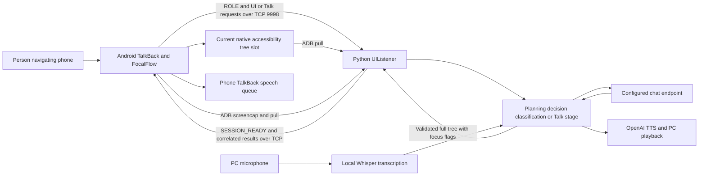

# Architecture and runtime boundaries

FocalFlow preserves a human-operated browsing flow. The backend proposes focus
regions; the person decides what to explore and activates controls on the phone.
The maintained path returns the full tree with focus flags changed. Legacy direct
`tap`/`slide` helpers remain in the source but are not a replacement navigation agent.



## Android

`TalkBackService` schedules native capture. `VirtualTreeBuilder` serializes
accessibility nodes; the capture's mapping owner is bound at admission and carried
through recursion. `NodeMappingManager` holds the native handles. `VirtualTreeManager`
maintains the source and filtered trees; `FocusProxy` restricts traversal when a
valid filter is active. Normal content notifications do not cancel admitted work.

`PcConnectionManager` owns TCP attempts, protocol readiness, contexts and requests.
The phone connects to local port 9998 through ADB reverse. It sends ROLE, then waits
for a strict matching SESSION_READY before exposing readiness/capture. Initial
pre-ACK EOF/timeouts keep bounded local waiting active. Once a session has been
acknowledged, disconnect takes the service-exit path. Explicit pause closes the
AI connection while retaining native browsing; explicit resume starts fresh work.
The selected baseline's retiring-capture race is documented in known issues.

Current transport uses one tree file beneath the application's external files:

```text
/storage/emulated/0/Android/data/com.android.talkback/files/screen_reader_logs/virtual_tree_logs/User_transport/Task_transport/virtual_tree_current.json
```

This Android path is a protocol constant. It does not refer to a desktop user's
home directory. Optional debug history is separate from the transport slot.

## Python

`backend/run.py` contains `UIListener` (admission, connection, bounded worker/reply
ownership) and `MobileAgentStateMachine` (Planning, Decision, Classification and
Talk stages). `MobileAgent/protocol.py` and `validation.py` reject malformed,
unowned or structurally invalid results. ADB acquisition in `controller.py` pulls
the tree and screenshot into owned temporary storage and checks the context.
Chat prompts/message construction remain in `prompt.py` and `chat.py`.

`api.py` owns provider and speech boundaries. Generated TTS plays on the PC.
The PC microphone records the existing five-second voice window; Whisper `base`
transcribes it locally. TalkBack announcements are produced on the phone through
Android's speech queue. Already submitted native operations/audio cannot all be
forcibly preempted by cancellation.

## Entry points and process supervision

`run.py` as a script is an unbounded live entry with its original hospital task
preset and exported API configuration. `tools/manual_testing/manual_test.py` is
the shared macOS launcher: it creates private session storage, discovers one ADB
phone, starts an independent guardian and launches its sibling `live_backend.py`.
Both modes use the burger preset. `scripts/run.sh` selects normal mode without
session-wide caps; `scripts/run-manual.sh` defaults to manual mode with 24 chat /
12 TTS / 600 second caps. Mode is validated and passed explicitly through guardian,
child and runtime. The 120-second request deadline remains in both modes.

The guardian observes the launcher through an inherited EOF pipe. It retains an
unreaped Darwin PID/PGID anchor while stopping its owned process group and has its
own wall deadline in manual mode. Cleanup removes only FocalFlow's modern and legacy own components
from the enabled accessibility-service list, preserving other services. Cleanup
failures report sanitized status. This is not a portability layer for other OSes.

Directory integration changes only local discovery/configuration and documentation.
Normal/manual mode selection changes session-wide limits; the protocol, presets,
per-request limits and Android production behavior are unaffected by that selection.
